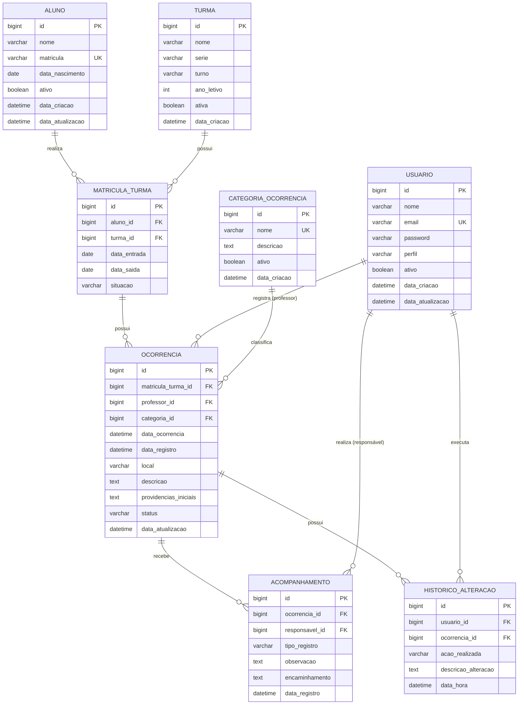

# AGENTS.md — SIGOE (Sistema Integrado de Gestão de Ocorrências Escolares)

> **Lema do Projeto:** *"Transformando registros escolares em informações para uma gestão pedagógica mais eficiente."*  
> **Objetivo:** Guia completo de contexto, arquitetura, modelo de dados, requisitos e diretrizes para agentes autônomos de IA e desenvolvedores que atuam neste repositório.

---

## 1. Visão Geral do Projeto

O **SIGOE** é uma aplicação web desenvolvida em **Python** com **Django** voltada para o ambiente escolar (gestão escolar e acompanhamento pedagógico). O sistema digitaliza, padroniza e otimiza o registro, consulta, tramitação e análise de ocorrências disciplinares e comportamentais de estudantes, superando a vulnerabilidade e ineficiência dos antigos cadernos e fichas físicas manuscritas.

### 1.1 Princípio Pedagógico Fundamental
> ⚠️ **Atenção:** O sistema deve registrar os fatos de maneira estritamente **descritiva e objetiva**, evitando rótulos, juízos de valor morais ou estigmatização dos estudantes. O foco do sistema é o **diálogo, a prevenção, o acompanhamento pedagógico e a melhoria do clima escolar**, em conformidade com as diretrizes do ECA e da LGPD.

---

## 2. Stack Tecnológica e Ferramentas

| Camada | Tecnologia | Finalidade |
| :--- | :--- | :--- |
| **Backend** | Python 3.12+ / Django | Framework web principal (MVT / Django ORM) |
| **Banco de Dados** | SQLite (Desenvolvimento) / PostgreSQL (Produção) | Persistência relacional de dados |
| **Frontend** | HTML5, CSS3, Bootstrap 5, JavaScript (Vanilla) | Interface responsiva, limpa e acessível |
| **Visualização** | Chart.js | Gráficos dinâmicos e indicadores nos dashboards |
| **Controle de Versão** | Git & GitHub | Rastreabilidade e colaboração de código |

---

## 3. Perfis de Usuário e Controle de Acesso (RBAC)

O sistema possui 3 perfis principais com níveis de permissão bem definidos:

1. **Administrador (`admin`):**
   - Gestão completa de usuários, professores, coordenadores e permissões.
   - Gestão de cadastros base: alunos, turmas e matrículas.
   - Configuração de categorias de ocorrências.
   - Acesso a logs de auditoria e relatórios gerenciais consolidados.

2. **Professor (`professor`):**
   - Autenticação e acesso rápido via desktop/mobile.
   - Consulta a turmas e alunos autorizados.
   - Registro detalhado de novas ocorrências escolares.
   - Consulta a histórico e registros efetuados por si mesmo.

3. **Coordenação Pedagógica (`coordenacao`):**
   - Triagem, análise e acompanhamento contínuo das ocorrências.
   - Adição de despachos, observações pedagógicas, atas de reuniões com responsáveis e encaminhamentos.
   - Alteração do ciclo de vida/status das ocorrências.
   - Acesso a dashboards analíticos, estatísticas e emissão de relatórios (PDF/filtros).

---

## 4. Modelagem de Dados (Entidades e Relacionamentos)

Baseado no diagrama relacional oficial do projeto:



### 4.1 Especificação das Entidades e Campos

1. **`Usuario` (custom user model ou estendendo AbstractUser):**
   - `id`: PK (BigAuto/UUID)
   - `nome`: Nome completo
   - `email`: Identificador único de acesso
   - `perfil`: `ADMIN`, `PROFESSOR`, `COORDENACAO`
   - `ativo`: Booleano (soft delete / ativação)
   - `data_criacao`, `data_atualizacao`

2. **`Aluno`:**
   - `matricula`: Código único do estudante na instituição
   - `nome`: Nome completo do estudante
   - `data_nascimento`: Para identificação de faixa etária e proteção de dados
   - `ativo`: Booleano indicando vínculo ativo

3. **`Turma`:**
   - `nome`: Ex: "9º Ano A", "3º Ano Informática"
   - `serie`: Ex: "9º Ano Ensino Fundamental", "3º Médio"
   - `turno`: Matutino, Vespertino, Noturno ou Integral
   - `ano_letivo`: Ano de exercício (ex: 2026)
   - `ativa`: Booleano

4. **`MatriculaTurma` (Tabela associativa com histórico temporal):**
   - `aluno`: FK -> `Aluno`
   - `turma`: FK -> `Turma`
   - `data_entrada`, `data_saida`: Controle de transferência/mudança de turma
   - `situacao`: `ATIVA`, `TRANSFERIDO`, `CONCLUIDO`, `CANCELADO`

5. **`CategoriaOcorrencia`:**
   - Categorias configuráveis: *Indisciplina*, *Conflitos entre estudantes*, *Desrespeito às normas escolares*, *Danos ao patrimônio*, *Dificuldades de convivência*, *Situações positivas / Atitudes de colaboração*, *Outras*.

6. **`Ocorrencia`:**
   - `matricula_turma`: FK -> `MatriculaTurma` (vincula o aluno e a turma no exato contexto do evento)
   - `professor`: FK -> `Usuario` (autor do registro)
   - `categoria`: FK -> `CategoriaOcorrencia`
   - `data_ocorrencia`, `data_registro`, `local`
   - `descricao`: Narrativa fática, objetiva e detalhada
   - `providencias_iniciais`: Ações imediatas tomadas pelo professor em sala/pátio
   - `status`: Ciclo de vida da ocorrência (detalhado a seguir)

7. **`Acompanhamento` (Gestão Pedagógica):**
   - `ocorrencia`: FK -> `Ocorrencia`
   - `responsavel`: FK -> `Usuario` (membro da coordenação pedagógica)
   - `tipo_registro`: Reunião com responsáveis, conversa de orientação, advertência, termo de compromisso, encaminhamento psicológico/conselho tutelar.
   - `observacao`, `encaminhamento`, `data_registro`

8. **`HistoricoAlteracao` (Auditoria & Rastreabilidade LGPD):**
   - Registra qualquer edição ou mudança de status para compliance e transparência: quem realizou (`usuario`), em qual ocorrência (`ocorrencia`), ação e timestamp.

---

## 5. Ciclo de Vida da Ocorrência (Status Flow)

```
[ REGISTRADA ] ──> [ EM ANÁLISE ] ──> [ EM ACOMPANHAMENTO ] ──> [ ENCAMINHADA ] ──> [ CONCLUÍDA ]
       │                                     │
       └─────────────────────────────────────┴───────────── (ou resolvida direto)
```

1. **Registrada:** Criada pelo professor; aguarda triagem da coordenação.
2. **Em Análise:** Coordenação acolheu o registro e está averiguando a situação.
3. **Em Acompanhamento:** Aplicação de planos de ação, intervenções e reuniões.
4. **Encaminhada:** Encaminhada para instâncias externas (Conselho Tutelar, apoio psicológico, direção).
5. **Concluída:** Ocorrência tratada, providências concluídas e caso encerrado.

---

## 6. Arquitetura Modular Recomendada (Django Apps)

O projeto deve ser estruturado de forma coesa e desacoplada em Django Apps:

```text
projeto_integrador_ocorrencias/
├── manage.py
├── ocorrencias/              # Configurações globais do Django (settings, urls centrais, wsgi, asgi)
│   ├── settings.py
│   ├── urls.py
│   ├── wsgi.py
│   └── asgi.py
│
├── core/                     # Home, landing page, mixins base, utilitários comuns
│
├── usuarios/                 # Custom User Model, autenticação, controle de permissões
│   ├── models.py
│   ├── forms.py
│   ├── views.py
│   └── urls.py
│
├── alunos/                   # Gestão de alunos, histórico acadêmico e prontuários
│
├── turmas/                   # Gestão de turmas, anos letivos e matricula_turma
│
├── registros/                # (ou ocorrencias_app) Registro das ocorrências e categorias
│
├── acompanhamento/           # Providências pedagógicas, reuniões e histórico de alterações
│
├── dashboards/               # Indicadores, estatísticas e gráficos Chart.js
│
├── relatorios/               # Exportação e emissão de relatórios (HTML para impressão e PDF)
│
├── templates/                # Templates Jinja/Django (base.html, layouts, parciais)
│   ├── base.html
│   ├── navbar.html
│   └── includes/
└── static/                   # CSS customizado, Bootstrap 5, JS e imagens
    ├── css/
    └── js/
```

---

## 7. Requisitos Funcionais (RF) e Não Funcionais (RNF)

### 7.1 Requisitos Funcionais
- **RF01:** Permitir autenticação de usuários por login e senha com proteção contra brute-force.
- **RF02:** Gerenciamento de usuários e perfis de acesso (RBAC: Admin, Professor, Coordenação).
- **RF03:** Cadastro, atualização e consulta de alunos.
- **RF04:** Cadastro e gerenciamento de turmas, séries, turnos e anos letivos.
- **RF05:** Cadastro e manutenção de categorias de ocorrências.
- **RF06:** Formulário intuitivo para professores registrarem ocorrências.
- **RF07:** Consulta e visualização do histórico disciplinar/pedagógico individual do aluno.
- **RF08:** Filtros multidimensionais (por aluno, turma, período, professor, categoria, status).
- **RF09:** Painel / Dashboard analítico dedicado à coordenação pedagógica.
- **RF10:** Geração de relatórios com visão geral e detalhada.
- **RF11:** Registro de pareceres, atas de reunião e encaminhamentos da coordenação.
- **RF12:** Manutenção de histórico auditável das alterações feitas nos registros.
- **RF13:** Gestão do status de tramitação da ocorrência.

### 7.2 Requisitos Não Funcionais
- **RNF01 (Segurança):** Senhas com hash Argon2/PBKDF2; verificação rigorosa de autorização nos views (Django `@login_required` e `PermissionRequiredMixin`/decoradores por perfil).
- **RNF02 (Usabilidade):** Interface limpa, formulários bem rotulados, feedback via Django Messages (Toast/Alerts).
- **RNF03 (Responsividade):** Layout mobile-first com Bootstrap 5 para fácil preenchimento em smartphones ou tablets por professores.
- **RNF04 (Integridade):** Restrições de integridade referencial com Foreign Keys, transações atômicas (`transaction.atomic`) e validações de formulário.
- **RNF05 (Desempenho):** Otimização de consultas ORM com `select_related` e `prefetch_related` para evitar problemas de N+1 queries.
- **RNF06 (Manutenibilidade):** Código no padrão PEP 8, modularizado por apps, views baseadas em classes (CBV) ou funções bem documentadas.
- **RNF07 (Disponibilidade):** Preparado para deploy WSGI/Gunicorn em contêineres ou instâncias cloud.
- **RNF08 (Privacidade & LGPD):** Dados sensíveis de menores de idade protegidos. Restrição de visualização de detalhes íntimos a pessoal não autorizado.

---

## 8. Escopo do MVP (Minimum Viable Product)

Para entregas iterativas rápidas, o MVP deve cobrir:
1. Autenticação e permissões por perfil.
2. CRUD de Usuários, Alunos e Turmas.
3. Associação Aluno-Turma (Matrícula).
4. Registro de Ocorrências pelo Professor.
5. Consulta ao Histórico de Ocorrências por Aluno e Turma.
6. Painel de Acompanhamento e atualização de Status pela Coordenação.
7. Dashboard com métricas essenciais (Total de ocorrências, ocorrências por status/turma).
8. Filtros básicos funcionais por aluno, turma e data.

---

## 9. Diretrizes para Agentes de IA e Desenvolvedores

Ao gerar código ou interagir com este repositório, os agentes e desenvolvedores devem seguir:

1. **Padrões Django:**
   - Utilize sempre `get_user_model()` para referenciar o usuário.
   - Nomeie campos em `snake_case` nos models e utilize verbose names amigáveis em português (`verbose_name`, `verbose_name_plural`).
   - Use `django.contrib.messages` para feedbacks de ações nos formulários.
   - Aplique validação nos forms (`forms.ModelForm`) antes de persistir dados.
   
2. **Consultas e ORM:**
   - Sempre utilize `select_related('matricula_turma__aluno', 'matricula_turma__turma', 'professor', 'categoria')` ao listar ocorrências.
   
3. **Segurança e Permissões:**
   - Nunca confie apenas em parâmetros enviados via GET/POST para verificar quem é o autor do registro. Use sempre `request.user`.
   - Professores só devem alterar/deletar ocorrências que criaram e antes de entrarem em análise, ou conforme regra de negócio restritiva.
   
4. **Convenções de Commit:**
   - Padrão Conventional Commits: `feat:`, `fix:`, `docs:`, `refactor:`, `test:`, `chore:`.

5. **Comandos Úteis:**
   ```bash
   # Ativar ambiente virtual (Windows PowerShell)
   .\venv\Scripts\Activate.ps1

   # Migrações
   python manage.py makemigrations
   python manage.py migrate

   # Executar servidor
   python manage.py runserver

   # Testes
   python manage.py test
   ```
